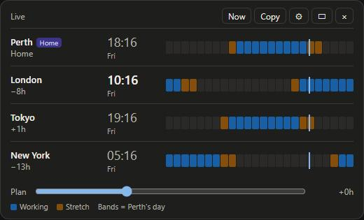
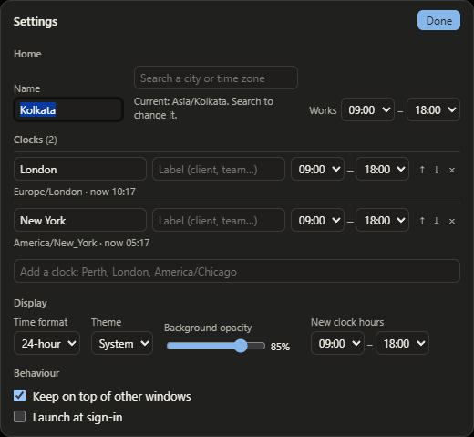

# World Clock

A small always-on-top world clock widget for Windows, macOS and Linux. Set your home, add the cities you work with, and see at a glance whether it's a good time to call them.



Built for working across time zones with clients in other countries. A plain list of times doesn't tell you much. This shows each city's working hours laid out on **your** day, so the overlap is obvious.

## Download

Get the latest installer from the [Releases page](https://github.com/ptalati/worldclock/releases/latest):

| System | File |
|---|---|
| **Windows** | `World.Clock_x.y.z_x64-setup.exe` (or the `.msi`) |
| **macOS** (Apple Silicon) | `World.Clock_x.y.z_aarch64.dmg` |
| **macOS** (Intel) | `World.Clock_x.y.z_x64.dmg` |
| **Linux** | `.AppImage` (any distro), `.deb` (Ubuntu/Debian) or `.rpm` (Fedora) |

The builds aren't code-signed yet, so the first launch shows a warning:

- **Windows:** SmartScreen says "Windows protected your PC". Click **More info**, then **Run anyway**.
- **macOS:** right-click the app in Applications, choose **Open**, then **Open** again. If macOS says the app is damaged, run `xattr -cr "/Applications/World Clock.app"` once in Terminal.
- **Linux (AppImage):** `chmod +x World.Clock_*.AppImage` and run it.

## What it does

- **Home plus any number of clocks.** Your home is the reference: every other clock shows its offset from it ("+5h 30m", "−8h").
- **Working-hour bands.** Each clock has a 24-hour bar on your day. Blue is their working hours, amber is the stretch hour either side, and the line is now.
- **Plan a time.** Drag the slider to move every clock forward or back in 15-minute steps. **Now** jumps back.
- **Copy** puts all the times on one line, ready to paste into an email.
- **Compact strip** (▭) shrinks it to a single line of times. Double-click the strip to expand it.
- **Tray icon.** Left-click to show or hide it. Right-click for Settings and Quit. The widget remembers where you put it.

## Settings

Open them with **⚙** in the widget, or **Settings…** in the tray menu.



- **Home:** search any city or time zone, rename it ("Ahmedabad" instead of "Kolkata") and set your own working hours.
- **Clocks:** add as many as you like, rename them, give them a label (client, team), set each one's working hours (overnight shifts work too), reorder or remove them.
- **Display:** 12h or 24h time, light, dark or system theme, background opacity (so whatever is behind it shows through), and default working hours for new clocks.
- **Behaviour:** keep on top of other windows, launch at sign-in.

Time zones use the IANA database built into the system, so daylight-saving changes are handled for you.

## Build it yourself

You need [Node.js](https://nodejs.org) 20+, [pnpm](https://pnpm.io) and [Rust](https://rustup.rs), plus the [Tauri prerequisites](https://tauri.app/start/prerequisites/) for your system.

```sh
pnpm install
pnpm tauri dev      # run it with live reload
pnpm tauri build    # make an installer in src-tauri/target/release/bundle
```

On Windows, `dev.ps1` runs `pnpm tauri dev` with a fresh PATH, which helps right after installing Rust.

Releases are built by GitHub Actions for every platform when a `v*` tag is pushed. See `.github/workflows/release.yml`.

## License

MIT
